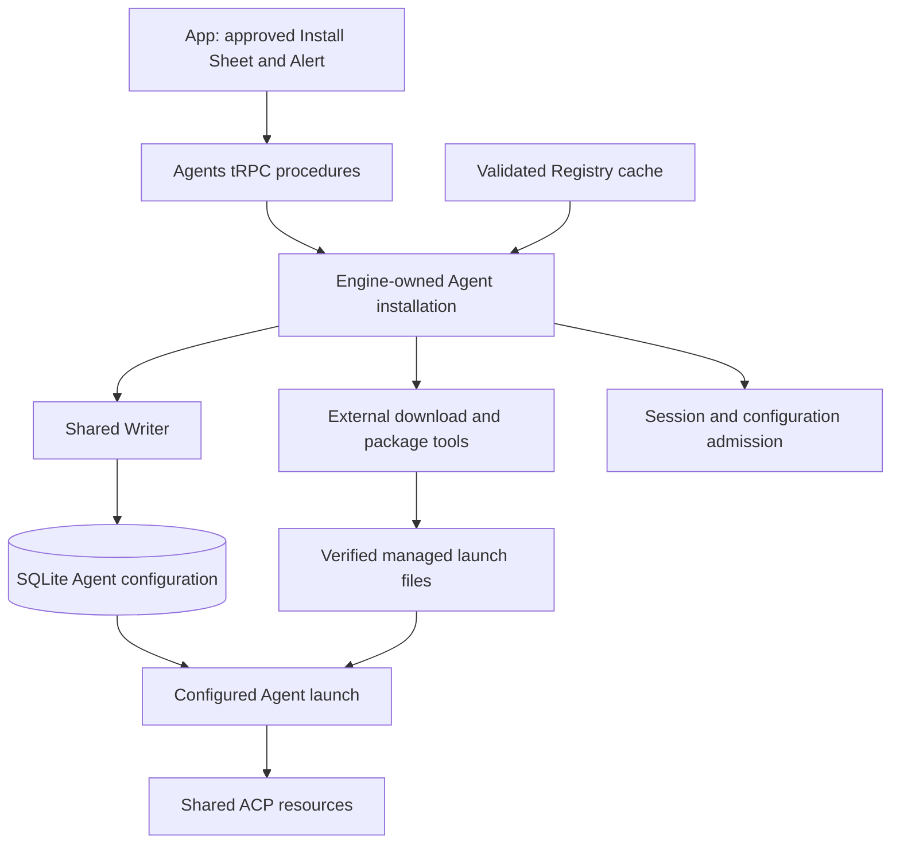

# Session owns one ACP session lease, and Engine owns shared transport

Spec 0009 supersedes the native ownership contract below (owner, 2026-10-09). Session owns one ACP session lease with official SDK role, identity/readiness and idempotent close. Engine owns shared startup, process lifetime, routing and retained reservations. A readonly released Promise observes cleanup without adding another release operation. Successful sibling closure proves its local protocol/callback/write drain; final and unresolved failure cases require process exit. Private helpers carry transport bookkeeping and no Turn/business lifecycle.

The ACP-configured public Session path now composes empty opening, prompted creation, successive text Turns and existing Blob image prompts. Thin procedures wait for local prompt commitment, then Session calls its official SDK peer directly. A single invoked callback supplies ordered updates throughout the Session lifetime; finite prompt and publication operations use promise invocations. Cancelling is a mode of the active Turn: Session sends `session/cancel` and settles its pending questions, then keeps the prompt invocation until its result ends the Turn. The optional composition dependency is temporary staging until final cutover. Configuration and content now run through Session for Spec 0009 #351. Empty opening supplies the actual Checkout-scoped options. Session applies configuration through a bounded local queue and replaces all options with authoritative responses or notifications before subsequent prompts. Queued choices are checked again against the latest model-dependent options; failures reach the caller. Ordinary cancellation bypasses configuration held behind that Turn. Explicit cancellation of empty creation awaits normal Session closure; navigation or App disconnect leaves ownership intact. Setup composition remains a dependent gate. The remaining description records the Spec 0008 native consumers during migration. Each Session owns its selected Agent adapter's native instance and Turn lifecycle (owner, 2026-10-09, Spec 0008). The earlier shared Agent machine repeated Session's idle/running/cancelling states and added an event hop. It is removed; there is no replacement Agent lifecycle controller.

An adapter is an `AgentAdapter` in the registry, `agentAdapters`. The Session invokes a private resource callback around the selected adapter's unchanged methods. The callback owns mapping state, early events, cancellation, native closure and command ordering, with no business lifecycle states. Its disposal aborts immediately and registers a pending stop promise. Session waits for current and retired native stops before Feed flush or Checkout discard, with the existing separate five-second native and Feed bounds. Recovery fences the previous instance and retains its cleanup while preserving the crash-anchored one-second retry.

The adapter remains plain functions and imports no XState:

- `connect(input, listener, signal)` starts or resumes the Agent session. It resolves to a `VendorSession`, holding ready data (`vendorSessionId`, `configOptions`, `capabilities`, `continuedOutside`), `run(command)` and `stop()`. The listener takes vendor messages, Agent events needing no mapping, and a failure. Session aborts startup and pending commands when the native lifetime ends; a late connection is still closed once.
- `toAgentEvents(message, mappingState)` maps one vendor message into Agent events. Mapping state belongs to that native lifetime; a rejected message does not replace the last accepted state.
- `initialMappingState()` initializes that state.

It also describes its Agent before any Session starts, for `agents.list` and the New Session composer (owner, 2026-10-05):

- `label` names the Agent in the UI, and `logo` is its SVG text, so no screen names a vendor.
- `probe(signal)` starts the vendor CLI briefly and resolves to the Agent's `availability`, its `installStep`, and the `configOptions` a New Session offers. It rejects when the CLI does not start, and the Server reports that as `unavailable`. The Server aborts the signal after a timeout. A probe applies the same sign-in rule as `connect`, so an Agent that `agents.list` shows as available can start a Session.

Session runs ordinary commands in order so configuration precedes the next prompt. Cancel, Permission and Elicitation answers wait for prior configuration, then bypass the pending prompt they can release. Accepted idle `agent.turnStarted` creates and persists an Argo Turn without a human prompt; duplicate starts retain the running Turn. Both Agent identities use this rule, with no guessed native start event. Ready data carries Session capabilities. Oxlint enforces the adapter's XState import boundary.

Inside an adapter and its response mocks, the vendor SDK's TypeScript types or generated protocol types describe vendor messages. ADR-0018 replaces CLI replay with pure translation unit tests and shared App fixtures. The shared Agent intake validates translated non-Feed events before Session mutation. The Feed validates the completed row after applying a translated change against the contract's `SessionUpdate` schema. Rejections are reported and counted; accepted early events are buffered without parsing them again when ready. ADR-0016 records production decoding of raw protocol JSON before it becomes a provider-owned value.

This follows old Argo's ADR-0047, which replaced its per-vendor machines with async clients and one generic session machine. Paseo has the same split between generic and vendor code, without XState.

## Considered Options

- A machine per adapter, as first designed. Replaced: the copies drift, every adapter needs its own model-based tests for the same states, and the Claude machine mapped each message twice to decide whether a Turn ended.
- A stateful class per vendor, as Paseo's `ClaudeAgentSession` is. Rejected: pure mapping is driven by typed response fixtures, with state owned by the Session's native lifetime.
- Zod schemas for every vendor message. Replaced: the SDK already types its messages, and the Feed checks the result against the contract.
- A shared Agent machine beneath each Session, the previous design. Replaced: Session already owns Turn state and recovery; its private resource callback preserves native ordering and cleanup without another lifecycle or event hop.

Spec 0009 #363 extends Agents with one Engine-owned installation operation per Agent definition. Its promise retains ownership until materialization and cleanup finish. Session admission rejects that Agent while setup owns it. Live and opening Sessions also prevent replacement. Configuration mutations reserve setup ownership until their Writer commit completes. Failed Writer attempts retain the reservation and selected files while the Writer retries.

A successful operation saves the selected upstream Registry record and exact distribution provenance in the existing Agent configuration. SQLite remains the only writable authority. Immutable managed directories contain the verified launch files. Registry refresh cannot change this selection. Session launch resolves those files through the existing shared ACP resource path. Installation status checks actual files; it never claims sign-in readiness from installation success.

Managed installation currently supports POSIX Servers. Windows requests return an unsupported-platform explanation before materialization starts. Windows support requires observed descendant cleanup before ownership can be released.

Each external installer starts behind a Node launch gate. Its process group and unique wrapper token are recorded and synced in staging before the gate opens. The wrapper keeps its group-leader identity through tool completion and SIGTERM; owned IPC carries the tool result until the parent observes group release. Engine IPC closure stops that group. The Supervisor releases recorded installer groups before reporting Engine cleanup complete, and startup observes those groups before deleting interrupted staging. A changed or unobservable group identity retains the record and blocks recovery. This preserves ownership across abrupt Engine exit and force-stop, including a wrapper that cannot handle IPC closure.

