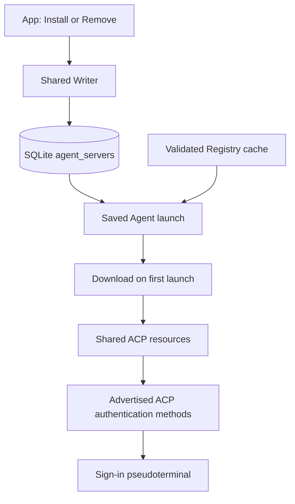

# Session owns one ACP session lease, and Engine owns shared transport

Spec 0009 #359 completes the ACP-only composition (owner, 2026-10-13). All Agent code lives under `packages/engine/src/agents`. Its private `acp/` group owns SDK transport, initialization, shared connection reuse, authentication and process cleanup. The public Agents interface exposes resource acquisition, Registry choices, authentication and launch types. Other domains do not import its private files.

Engine constructs the resource owner. Each Session owns one ACP session lease, its Checkout, configuration, pending questions and Turn lifecycle. It calls the official SDK directly. There is no native adapter registry, Agent command facade or replacement Agent event protocol. Agents never imports Session or Feed implementation details.

Session invokes one callback subscription across opening, Turns and awaited closure. Finite SDK operations use promise invocations. Cancellation keeps the prompt result observed through final output. Configuration responses and notifications supply authoritative options; queued choices are checked again before application. Feed owns content assembly. Writer owns durable transactions and draining.

One connection module per Agent and Project shares its startup promise, as Zed's AgentConnectionStore does. Failed startup is forgotten. A connection stays until Agent removal or save, process exit, Retry, or Engine shutdown. A newer Registry version moves new opens to a new connection; the older connection stops after its last Session ends. There is no other idle stop. Close sends optional `session/close`, then drains under the five-second deadline. On failure, it logs and releases without killing the process. A process exit closes its Sessions; the next Send resumes them. There is no automatic reopen or crash budget (owner, 2026-10-15, #717).

Saved Registry rows determine which Agents can start Sessions. Install saves the choice; the Agent downloads on first launch; Remove deletes the choice. New connections use the Registry's current version. Open Sessions keep their connection. A removed Agent's past Sessions retain their Feed; Send shows `Agent "{id}" is not installed.` Sign-in follows advertised ACP methods through `agents/auth/` (Spec 0014 #721, owner, 2026-10-16).

The owner authorized #359 implementation while keeping missing live upstream checks as explicit #360 gates. Scripted tests establish Argo behavior. They do not establish authenticated billing, upstream cleanup isolation, descendant containment or resource savings.

## Considered Options

- Argo-owned native adapters and generated native readers: removed by #359. Maintained upstream ACP implementations own native translation.
- A separate Agent lifecycle machine: rejected. Session already owns Turn admission and recovery.
- A command facade over the SDK: rejected. Session calls the official SDK role directly.

Spec 0014 #722 removes the old installer, catalog sync and sign-in lifecycle. Archive, download and npm helpers live under `agents/launch/`. Tools share the Engine process group. Sign-in uses a direct pseudoterminal, with no durable process records. Session launch resolves `agent_servers` through the shared Registry get-command path. A download reservation remains held until ACP owns the installation directory, or opening fails. Cancelling a Session also cancels its pending download. The external download and npm ports supply files, timing and failures.

