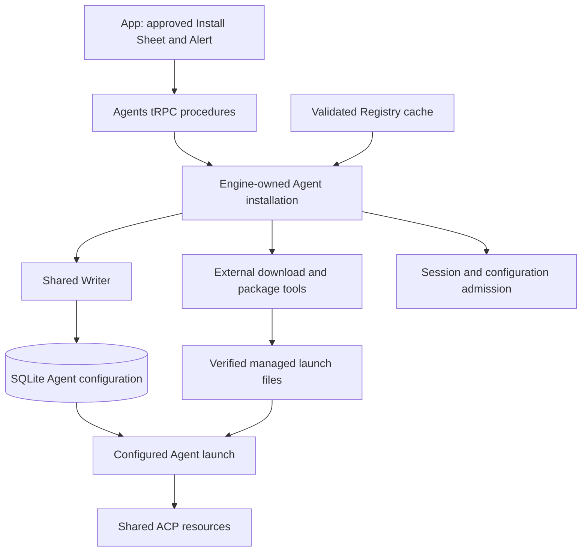

# Session owns one ACP session lease, and Engine owns shared transport

Spec 0009 #359 completes the ACP-only composition (owner, 2026-10-13). All Agent code lives under `packages/engine/src/agents`. Its private `acp/` group owns SDK transport, initialization, shared connection reuse, authentication and process cleanup. The public Agents interface exposes resource acquisition, configuration, setup and launch types. Other domains do not import its private files.

Engine constructs the resource owner. Each Session owns one ACP session lease, its Checkout, configuration, pending questions and Turn lifecycle. It calls the official SDK directly. There is no native adapter registry, Agent command facade or replacement Agent event protocol. Agents never imports Session or Feed implementation details.

Session invokes one callback subscription across opening, Turns, recovery and awaited closure. Finite SDK operations use promise invocations. Cancellation keeps the prompt result observed through final output. Configuration responses and notifications supply authoritative options; queued choices are checked again before application. Feed owns content assembly. Writer owns durable transactions and draining.

An awaited lease close settles protocol requests and drains callbacks before releasing its connection reference. Failed cleanup retains ownership and blocks unsafe Checkout reuse or discard. Final release observes process exit. Navigation and App disconnection do not close a Session.

Availability comes from saved registry/custom configurations and current ACP checks. The SQLite selection pins a release; registry refresh does not upgrade it. Removed and disabled configurations preserve existing Session history. Subscription credentials stay upstream. Sign-in uses advertised ACP protocol or terminal methods through the Agents setup operations.

The owner authorized #359 implementation while keeping missing live upstream checks as explicit #360 gates. Scripted tests establish Argo behavior. They do not establish authenticated billing, upstream cleanup isolation, descendant containment or resource savings.

## Considered Options

- Argo-owned native adapters and generated native readers: removed by #359. Maintained upstream ACP implementations own native translation.
- A separate Agent lifecycle machine: rejected. Session already owns Turn admission and recovery.
- A command facade over the SDK: rejected. Session calls the official SDK role directly.

Spec 0009 #363 extends Agents with one Engine-owned installation operation per Agent definition. Its promise holds ownership until materialization and cleanup finish. Session admission rejects that Agent while setup owns it, and live or opening Sessions prevent replacement. Configuration mutations reserve setup ownership until their Writer commit completes. Failed Writer attempts retain the reservation and selected files while the Writer retries.

A successful operation saves the selected upstream Registry record and exact distribution provenance in the existing Agent configuration. SQLite remains the only writable authority. Immutable managed directories contain the verified launch files. Registry refresh cannot change this selection. Session launch resolves those files through the existing shared ACP resource path. Installation status checks actual files and never infers sign-in readiness from installation success.

Managed installation currently supports POSIX Servers only. Windows requests return an unsupported-platform explanation before materialization; Windows support needs observed descendant cleanup before ownership is released.

Each external installer starts behind a Node launch gate. Its process group and unique wrapper token are recorded and synced in staging before the gate opens. The wrapper keeps its group-leader identity through tool completion and SIGTERM; owned IPC carries the tool result until the parent observes group release. Engine IPC closure stops that group. The Supervisor releases recorded installer groups before reporting Engine cleanup complete, and startup observes those groups before deleting interrupted staging. A changed or unobservable group identity retains the record and blocks recovery. This preserves ownership across abrupt Engine exit and force-stop, including a wrapper that cannot handle IPC closure.

